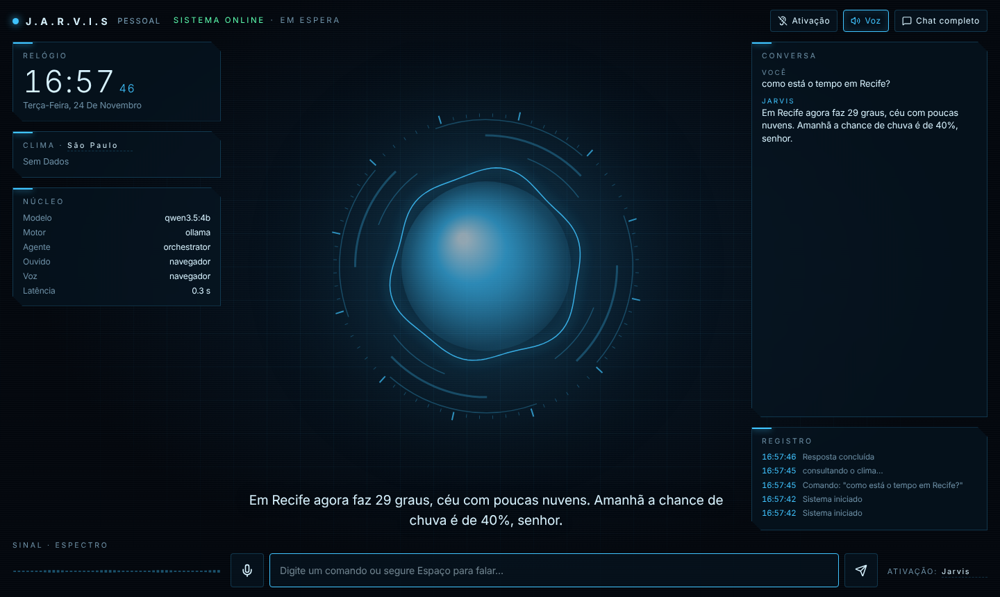

# Jarvis Pessoal

Assistente pessoal por voz, em português, que roda no seu PC. É construído em cima do [OpenJarvis](https://github.com/open-jarvis/openjarvis) (Stanford, licença Apache 2.0), com estas adições:

- **Tela de comando (HUD)** em `/hud`: núcleo animado que muda de cor quando escuta, pensa e fala, espectro de áudio ao vivo, cards de relógio, clima e sistema, conversa e registro de atividades. Abre sozinha ao iniciar.
- **Voz em português**: transcrição local (Whisper) e voz local brasileira (Kokoro). Sem esses, ele usa o reconhecimento e a voz do navegador.
- **Palavra de ativação**: ligue "Ativação" e diga "Jarvis, ..." (no Chrome ou Edge). Ou segure **Espaço** para falar, ou clique no núcleo.
- **Controle do PC**: abrir programas e sites, tocar no YouTube, volume, mídia e bloquear a tela.
- **Clima grátis** (Open-Meteo, sem chave).
- **Preset `jarvis-pt`**: personalidade em português, IA local pelo Ollama, tudo grátis.

## Instalar no Windows

Dê dois cliques no **`Jarvis.exe`**. Pode deixar ele em qualquer lugar (Área de Trabalho, por exemplo).

Na primeira vez ele instala o que falta (Git, uv, Node.js, Ollama, eSpeak), baixa este projeto para `%LOCALAPPDATA%\JarvisPessoal`, prepara o Python, configura em português e baixa o modelo de IA (uns 3 GB). Nas próximas vezes ele só procura atualizações e abre o Jarvis numa janela própria de aplicativo (sem abas nem barra de endereço). Para sair, feche a janela do Jarvis: o núcleo desliga junto. Na primeira vez a janela pede permissão do microfone; aceite e ela fica salva.

Se o Windows mostrar "O Windows protegeu o computador", clique em **Mais informações > Executar assim mesmo** (o programa não é assinado digitalmente). O `iniciar-jarvis.bat` faz a mesma coisa, se preferir.

**Máquina:** 8 GB de RAM já rodam o modelo `qwen3.5:4b`. Com placa de vídeo de 8 GB ou mais, troque para `qwen3.5:9b` em `%USERPROFILE%\.openjarvis\config.toml`, que entende bem melhor.

## Usar o Gemini em vez da IA local (opcional, também grátis)

Se o PC for fraco, dá pra usar o Google Gemini no plano gratuito: abra **Settings** no menu lateral, cole sua chave do Gemini nos provedores de nuvem e escolha um modelo `gemini-...` na lista (Ctrl+K). A chave fica só no seu PC.

## Exemplos

- "Jarvis, como está o tempo em Recife?"
- "Toca Legião Urbana no YouTube"
- "Abre o Spotify" / "Aumenta o volume" / "Pausa a música"
- "Pesquisa as notícias de hoje sobre tecnologia"
- "Bloqueia a tela"

## Personalizar

- **Personalidade e modelo:** `%USERPROFILE%\.openjarvis\config.toml` (veja `configs/openjarvis/examples/jarvis-pt.toml`).
- **Mais programas:** crie `%USERPROFILE%\.openjarvis\apps.json`, por exemplo `{ "discord": "C:\\Users\\voce\\AppData\\Local\\Discord\\Update.exe", "steam": "steam:" }`.
- **Voz:** `voice_id = "pf_dora"` para voz feminina, `"pm_alex"` para masculina.
- **Palavra de ativação e cidade do clima:** direto na tela HUD.

## Onde está cada coisa

| Arquivo | O que é |
|---|---|
| `frontend/src/pages/HudPage.tsx`, `hud.css` | Tela de comando |
| `src/openjarvis/tools/pc_control.py` | Ferramentas de controle do PC e clima |
| `configs/openjarvis/examples/jarvis-pt.toml` | Preset em português |
| `Jarvis.exe` (código em `launcher/`) | Instalador, atualizador e inicializador do Windows |
| `iniciar-jarvis.bat` | Alternativa em .bat |

O resto é o OpenJarvis original. Veja o `README.md` para a documentação completa dele.
